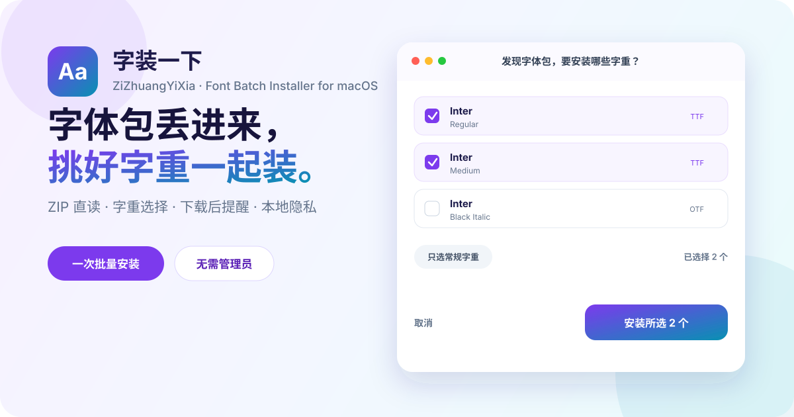

<div align="center">
  

  <h1>字装一下</h1>

  <p><strong>下载字体包之后，不该再一个个点“安装”。</strong></p>
  <p>一个原生、轻量、注重隐私的 macOS 批量字体安装器。</p>

  <p>
    <a href="https://github.com/guaiwu012/font-batch-installer/releases/latest"><strong>下载最新版</strong></a>
    ·
    <a href="https://github.com/guaiwu012/font-batch-installer/issues/new?template=bug_report.yml">报告问题</a>
    ·
    <a href="https://github.com/guaiwu012/font-batch-installer/issues/new?template=feature_request.yml">许愿新功能</a>
  </p>

  <p>
    
    
    
    
  </p>
</div>

---

## 为什么做它？

一个字体包里常常有十几个字重。macOS 的字体册却要你重复打开、确认、安装——下载字体的兴奋，很快就被机械点击磨没了。

「字装一下」把这段流程缩成三步：

1. 把字体、ZIP 或整个文件夹拖进来；
2. 看清字体家族与字重，勾选真正需要的版本；
3. 一次确认，批量安装。

## 亮点

| 功能 | 说明 |
| --- | --- |
| ZIP 直接读取 | 不用手动解压，中文文件名字体包也能识别 |
| 字重选择 | 安装前展示字体家族、样式与文件名，支持全选、只选常规字重、清空 |
| 下载后提醒 | 监控“下载”文件夹；只有确认 ZIP 内含字体时才弹出，不打扰普通压缩包 |
| 开机自动监控 | 可在设置中启用轻量后台监控器，发现字体包后再唤醒主应用 |
| 文件夹递归扫描 | 一次处理嵌套目录中的字体与 ZIP |
| 安全更新 | 相同字体自动跳过；同名旧版本先备份再更新 |
| 避免同名覆盖 | 不同字体即使都叫 `Regular.ttf`，也不会互相顶掉 |
| 当前用户安装 | 写入 `~/Library/Fonts`，不需要管理员密码 |
| 原生体验 | SwiftUI 构建，支持浅色/深色模式、键盘操作和 VoiceOver 标签 |

支持格式：`OTF`、`TTF`、`TTC`、`OTC`、`DFONT`、`ZIP`。

> TTC / OTC 是字体集合文件，包含的多个字重会作为一个文件整体安装。

## 安装

### 推荐：下载应用

1. 前往 [Releases](https://github.com/guaiwu012/font-batch-installer/releases/latest) 下载 `ZiZhuangYiXia-macOS.zip`；
2. 解压后把「字装一下.app」拖进“应用程序”；
3. 首次打开后，把字体包拖进窗口即可。

当前 Release 为 Apple Silicon（M 系列）版本，要求 macOS 14 或更高版本。

### 从源码构建

需要 macOS、Xcode Command Line Tools 和 Swift 工具链：

```bash
git clone https://github.com/guaiwu012/font-batch-installer.git
cd font-batch-installer
./test.sh
./build.sh
```

构建产物位于 `dist/字装一下.app`。

## 下载监控如何工作？

- 应用运行时，只观察本机“下载”文件夹的新增文件；
- ZIP 会在本机临时目录解压检查；普通 ZIP 不会弹窗；
- 不上传字体、文件名或使用数据；
- 关闭窗口后应用留在菜单栏继续监控，可随时暂停或退出；
- “开机后自动监控”是可选项，需要用户主动开启。

## 我很想听到你的反馈

这个工具就是从“每次都要手点安装，好麻烦”开始的。任何一个小麻烦，都可能值得变成下一个版本。

- 遇到字体包打不开、字重识别不对或安装失败？[提交 Bug](https://github.com/guaiwu012/font-batch-installer/issues/new?template=bug_report.yml)
- 想要 Intel Mac、字体预览、卸载管理或更多压缩格式？[发起功能建议](https://github.com/guaiwu012/font-batch-installer/issues/new?template=feature_request.yml)
- 不确定是不是 Bug？直接 [开一个 Issue](https://github.com/guaiwu012/font-batch-installer/issues/new/choose)，不用担心描述不够“专业”。

Issue 可以用中文或英文。能附上 macOS 版本、字体格式和复现步骤，会特别有帮助；请不要上传没有再分发授权的商业字体文件。

如果它帮你少点了几十次鼠标，欢迎点个 Star，让更多设计师看到它。

## 开发与贡献

项目保持零第三方运行时依赖，核心由 SwiftUI、AppKit、CoreText 和 macOS 系统工具组成。开始贡献前请阅读 [CONTRIBUTING.md](CONTRIBUTING.md)。

```text
Sources/
  App.swift                 应用生命周期、菜单栏与下载监控
  ContentView.swift         主界面与字重选择
  FontBatch.swift           字体元数据解析与 ZIP 批次准备
  FontInstaller.swift       安装、去重、备份与冲突处理
  ArchiveUtilities.swift    ZIP 检查与解压
Watcher/
  WatcherMain.swift         可选的开机后台监控器
Tests/
  FontInstallerTests.swift  安装与 ZIP 流程测试
```

## 许可证

[MIT](LICENSE) © 2026 guaiwu012

